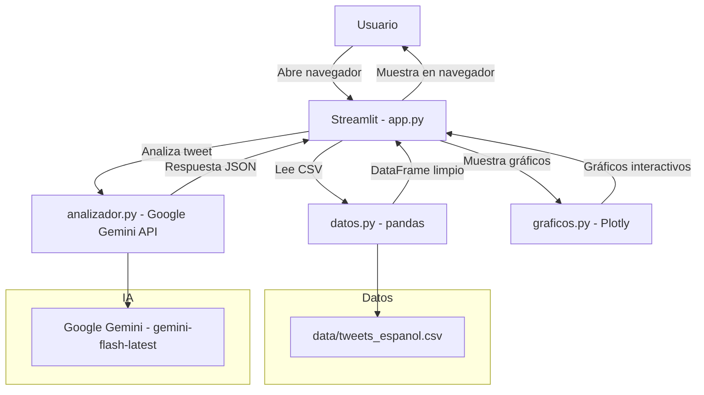

# Arquitectura del Sistema

**Estándar:** arc42  
**Versión:** 1.0.0  
**Fecha:** 2026-08-03

---

## 1. Visión General

Vibe Check IA es una arquitectura de 3 capas que separa claramente la lógica de negocio, la presentación y los datos.



## 2. Componentes

### 2.1 Capa de Datos (`src/datos.py`)

**Responsabilidad:** Leer, limpiar y filtrar el dataset CSV.

- Usa `pandas` para cargar el CSV en un DataFrame.
- Limpia texto vacío y valores nulos.
- Filtra por sentimiento cuando el usuario lo solicita.

### 2.2 Capa de Análisis (`src/analizador.py`)

**Responsabilidad:** Comunicarse con la API de Google Gemini.

- Lee la API Key desde variables de entorno (.env).
- Envía cada tweet al modelo `gemini-flash-latest`.
- Procesa la respuesta y clasifica el sentimiento.
- Maneja errores de red y de API.

### 2.3 Capa de Visualización (`src/graficos.py`)

**Responsabilidad:** Crear gráficos interactivos con Plotly.

- **Gráfico de pastel:** Distribución de sentimientos.
- **Gráfico de barras:** Conteo de emociones.
- **Gráfico de línea de tiempo:** Evolución temporal de sentimientos.

### 2.4 Capa de Presentación (`app.py`)

**Responsabilidad:** Dashboard interactivo con Streamlit.

- Sidebar con filtros de sentimiento.
- Botón "Analizar Tweets".
- Visualización de gráficos y tabla de datos.

## 3. Flujo de Datos

```
1. Usuario abre http://localhost:8501
2. Streamlit carga y lee el CSV con datos.py
3. Usuario selecciona filtro de sentimiento
4. Si presiona "Analizar", analizador.py envía tweets a Gemini
5. Gemini devuelve sentimiento confirmado
6. graficos.py genera los gráficos interactivos
7. Streamlit muestra todo en el navegador
```

## 4. Dependencias Externas

| Servicio | Uso | Dependencia |
|----------|-----|-------------|
| Google Gemini API | Análisis de sentimientos | `google-generativeai` |
| Kaggle | Dataset de tweets | Archivo CSV local |
| Streamlit | Dashboard web | `streamlit` |
| Plotly | Gráficos interactivos | `plotly` |
| Pandas | Manipulación de datos | `pandas` |

## 5. Seguridad

- La API Key se almacena en `.env` (nunca en código).
- `.gitignore` excluye `.env` y `data/` del repositorio.
- No se envían datos personales a la API de Gemini.

## 6. Métricas de Calidad

| Métrica | Objetivo |
|---------|----------|
| Cobertura de código | ≥ 90% |
| Tasa de tests aprobados | ≥ 80% |
| Tiempo de ejecución de tests | < 60 segundos |
| Manejo de errores | 100% de errores capturados |
