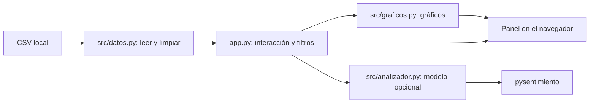

# Arquitectura: entiende cómo llega un comentario a la pantalla

## Programa de referencia

El punto de entrada actual es app.py. Es una sola aplicación con funciones separadas por responsabilidad.



| Parte | Entrada | Proceso | Salida |
|---|---|---|---|
| datos.py | Ruta del CSV | Leer, renombrar columnas, quitar textos vacíos, traducir etiquetas y filtrar | Tabla de comentarios |
| analizador.py | Texto | Preprocesar y ejecutar un modelo local | Etiqueta actual de sentimiento |
| graficos.py | Tabla | Contar categorías y preparar visualizaciones | Figuras y nube de palabras |
| app.py | Datos y acciones del usuario | Coordinar la interacción | Panel visible |

La referencia espera data/sentiment_analysis_dataset.csv. Importa pysentimiento; no llama a Gemini. Los gráficos pueden mostrar etiquetas originales del CSV sin ejecutar clasificación.

El código actual mantiene nombres antiguos como sentimiento_gemini. Ese nombre no demuestra una llamada a Gemini. Antes de modificarlo, revisa qué función escribe el valor y qué gráfico lo lee.

## Lo que construirás en clase

En otra carpeta, las responsabilidades propuestas son carga, métricas, reglas e interfaz. Los [prompts](../../CLASE_OPENCODE_Y_CHAT.md) usan app/main.py y src/analizador/. Es la estructura de la reconstrucción, no la ubicación actual del modelo de referencia.

```text
Comentario
 -> validación
 -> selección del lote
 -> clasificación por reglas
 -> resultado relacionado por id
 -> conservación durante la sesión
 -> filtros
 -> indicadores, tabla, gráfico y descarga
```

Separar responsabilidades permite probar un cálculo sin abrir el navegador. El primer panel puede empezar como un archivo breve; después se extraen funciones y se comprueba que siga funcionando.

## Decisiones que debes verificar

- La cantidad de resultados coincide con la del lote seleccionado.
- Cada resultado corresponde al id de su comentario.
- Error de procesamiento y Neutral son estados distintos.
- Tabla, indicadores y descarga describen las mismas filas visibles.
- Un cambio de filtro conserva el análisis; un cambio de archivo evita usar resultados anteriores como nuevos.
- Una gráfica temporal requiere fechas válidas y ordenadas.

Estas decisiones se escriben primero en [la hoja de trabajo](../../HOJA_DE_TRABAJO.md) y se comprueban al construir. Consulta [estado.md](estado.md) para las limitaciones que aún tiene la referencia.
